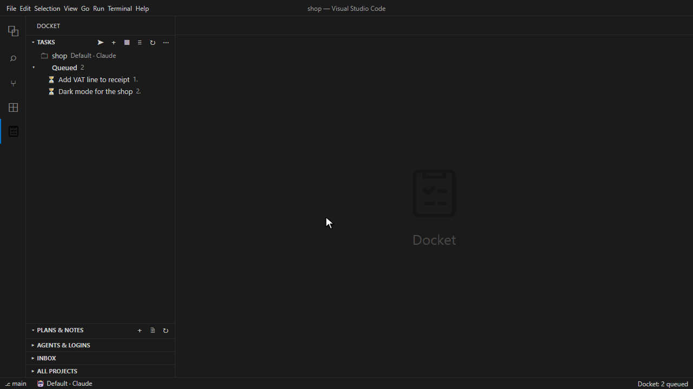

# Docket

**A task queue for AI coding agents in VS Code.** Write tasks with screenshots and files, queue the ones you want done, and send the queue to Claude Code, GitHub Copilot, Cursor, Codex, Gemini CLI, Qwen Code, OpenCode, GitHub Copilot CLI or the Cursor CLI. The agent works through them one at a time and reports back on each. Or chat with Claude Code and Codex in a panel of their own, with images, files and their questions answered in one click.

This repository is where you report problems, suggest ideas and follow releases. It holds no source code: Docket is proprietary software by Polestar Tech Consultancy LLP.

## Install

- **VS Code:** open the Extensions view (Ctrl+Shift+X), search for **Docket** and click **Install**, or [open it in the Marketplace](https://marketplace.visualstudio.com/items?itemName=polestar-tech.docket).
- **Cursor, Windsurf, VSCodium:** search for **Docket** in the Extensions view, or [open it on Open VSX](https://open-vsx.org/extension/polestar-tech/docket).

Install Docket only from these two stores. Copies from anywhere else are not authorised and may have been changed.

Docket follows your editor's display language: English, French, German, Spanish, Italian, Portuguese (Brazil), Russian, Turkish, Japanese and Korean.

## Get help

| You want to… | Go to |
| --- | --- |
| Report something that doesn't work | [New bug report](https://github.com/polestar-tech/docket/issues/new?template=bug_report.yml) |
| Suggest a feature or an improvement | [New feature request](https://github.com/polestar-tech/docket/issues/new?template=feature_request.yml) |
| Ask how to do something | [Discussions → Q&A](https://github.com/polestar-tech/docket/discussions/categories/q-a) |
| Share an idea before it's a request | [Discussions → Ideas](https://github.com/polestar-tech/docket/discussions/categories/ideas) |
| Report a security problem | Privately, as described in [SECURITY.md](https://github.com/polestar-tech/docket/blob/main/SECURITY.md); never in a public issue |
| Contact us about anything else | docket@polestartechno.com |

Before opening an issue, search the [existing issues](https://github.com/polestar-tech/docket/issues?q=is%3Aissue) and add a 👍 to one that matches yours: it helps us see what matters most.

## Learn Docket

The full user guide is inside the extension: in the Docket sidebar, open the Tasks view's **…** menu → **Open User Guide**, or run **Docket: Get Started** from the Command Palette. **Docket: Why Docket?** shows the five problems it solves, with a button to try each answer.

## FAQ

**Do I need an account?** 
No. Docket has no account, no sign-up and no server of its own. It runs on your computer and hands your tasks to the agent you already use, signed in as you are.

**Which agents does it work with?** 
Claude Code (the VS Code extension or the CLI), GitHub Copilot, Cursor, Codex, Gemini CLI, Qwen Code, OpenCode, GitHub Copilot CLI and the Cursor CLI. Connect each once: Tasks view **…** menu → **Connect an Agent…**.

**Does Docket send my code or tasks anywhere?** 
Only to the agent you choose, and to Notion if you connect it. Tasks stay on your computer in `~/.docket`, or in a `.docket` folder in the project if you choose to share them with your team through git.

**I can't find Docket in Cursor's Extensions view.** 
Cursor installs from Open VSX, and its search can take a while to show a new version. In Cursor's agent window, open the editor first (**IDE** at the top right), then the Extensions view, or use the [Open VSX page](https://open-vsx.org/extension/polestar-tech/docket).

**What happens when I hit my usage limit?** 
Docket shows the pause and when it ends, and the queue carries on after the reset, overnight too. If you like, another of your Claude logins or Codex accounts, or another agent, takes over meanwhile (*Auto Resume: Fallback Login* and *Fallback Agent*, off by default).

**Can each project use its own Claude account?** 
Yes. Add your logins with Tasks view **…** menu → **Connected Agents** → **Claude Code** → **Claude Logins…**, then right-click a project → **Choose Claude Login…**. Codex and Copilot accounts work alike (**Choose Codex Account…**, **Choose Copilot Account…**). A project's own Claude login needs Claude in a terminal; the Claude tab always uses your default login. **Logins & Usage** shows each one's usage.

**Does Docket turn off the agent's permission prompts?** 
No. The agent asks as usual. So that it doesn't stop at night waiting for you, allow the commands your tasks need in the agent's own settings beforehand (in Claude Code: `/permissions`). In Docket's chat, Claude's prompts can be answered with a click; that needs Node.js on your computer.

**Why does the Claude tab wait for me to press Enter?** 
Claude Code lets other extensions fill in its prompt but not send it. With *Send: Target* set to `terminal` (the default), Claude starts working at once.

**Can several agents work on one queue?** 
Yes. Send asks how many sessions to start (up to 3 per project by default); each takes its own tasks. Turn on *Sessions: Worktrees* to give each extra session its own git worktree.

**Is Docket in my language?** 
It follows your editor's display language: English, French, German, Spanish, Italian, Portuguese (Brazil), Russian, Turkish, Japanese and Korean. The user guide is in English.

Not answered here? Ask in [Discussions → Q&A](https://github.com/polestar-tech/docket/discussions/categories/q-a).

## Agent skill

[`skills/docket`](skills/docket/SKILL.md) is Docket's agent skill: the rules your agent follows to work your queue. Install it from VS Code with **Install Agent Skill…** (Tasks view **…** menu), or with `npx skills add polestar-tech/docket`. The skill needs the extension: Docket's tools come from it.

## Releases

Each version's changes are listed under [Releases](https://github.com/polestar-tech/docket/releases) and on the Changelog tab of the Marketplace page.

## Your privacy

Docket keeps your tasks, plans and notes on your own computer and sends nothing to us. When you open an issue here, it is public: leave out private code, customer data, file paths you'd rather not share, and any keys or tokens.

---

© 2026 Polestar Tech Consultancy LLP. All rights reserved. Docket is used under its end-user licence agreement, shown on the Marketplace page.
